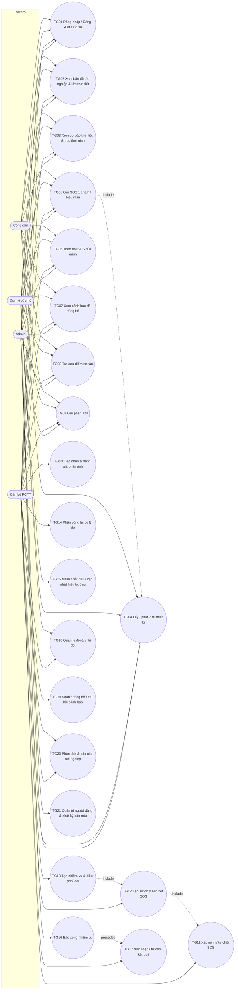

# Use case V2 — TG01–TG21 với 4 actor

Actor V2: **Admin** (`admin`), **Cán bộ PCTT** (`disaster_officer`), **Đơn vị cứu hộ** (`rescue_unit`), **Công dân** (`citizen`). Mọi actor đều phải qua **Đăng nhập (TG01)** trước; **cả 4 actor đều gửi được SOS (TG05)**.

## Sơ đồ use case (Mermaid)

## Bảng TG01–TG21

| UC | Tên | Actor V2 | Điều kiện / quy tắc chính | Nơi thực hiện | Quyền | Test |
| --- | --- | --- | --- | --- | --- | --- |
| TG01 | Đăng nhập / đăng xuất / hồ sơ | 4 actor | 7 tài khoản, mật khẩu `VNDMS@2026`, phiên 8 h; migration vai V2 chạy trước khi đọc user | `/login`, `/profile` | — | `authentication-session`, `role-model-migration` |
| TG02 | Xem bản đồ tác nghiệp & lớp thời tiết (kiểu Windy) | 4 actor (công dân qua Cổng công dân) | Công cụ/lớp/thời gian/panel dùng chung; công dân chỉ thấy lớp công khai (điểm sơ tán, SOS của mình) | Bản đồ tác nghiệp, Cổng công dân | `view` / `sos_create` | `unified-operational-map` |
| TG03 | Xem dự báo thời tiết & trục thời gian | 4 actor | Nguồn ECMWF/Open-Meteo, ghi rõ mô hình/thời điểm | Bản đồ, EcmwfWeatherPanel, Cổng công dân | — | `weather-pipeline` |
| TG04 | Lấy / phát vị trí thiết bị | 4 actor | **Không** dùng tọa độ mặc định; không có GPS → báo "chưa lấy được vị trí" | LiveTrackingQuickBar | — | — (UI) |
| TG05 | Gửi SOS (1 chạm hoặc biểu mẫu) | **4 actor** | SOS gắn `ownerUserId`; 1 chạm chỉ gửi khi có GPS thật; thông báo nêu đúng việc đã xảy ra (tạo SOS, chờ tiếp nhận) | QuickBar, Cổng công dân, `/sos` | `sos_create` | `sos-management`, `p0-resource-mutation-authorization` |
| TG06 | Theo dõi SOS của mình | 4 actor | Công dân chỉ thấy SOS có `ownerUserId` = mình | Cổng công dân, `/sos` | `sos_view_own` | `p0-read-authorization` |
| TG07 | Xem cảnh báo đã công bố | 4 actor | Công dân/không có `published_alert_manage` chỉ thấy "Đã công bố" | `/alerts` | `published_alert_view` | `published-alert-management` |
| TG08 | Tra cứu điểm sơ tán | 4 actor | Danh mục dùng chung; không còn lệnh sơ tán | `/shelters`, Cổng công dân | `shelter_view` / `published_alert_view` | `p0-read-authorization` |
| TG09 | Gửi phản ánh | 4 actor | Phản ánh gắn `ownerUserId`; loại/mô tả/vị trí | Cổng công dân | `report_create` | `citizen-report-management` |
| TG10 | Tiếp nhận & đánh giá phản ánh | Cán bộ PCTT | Tiếp nhận / chuyển SOS / trùng (kèm ID) / từ chối (kèm lý do) | `/reports` | `report_review` | `citizen-report-management` |
| TG11 | Xác minh / từ chối SOS | Cán bộ PCTT | Mới tiếp nhận → Đang xác minh → Đã xác minh / Từ chối; admin không có quyền | `/sos/:id` | `sos_verify` | `sos-management`, `command-center-actions` |
| TG12 | Tạo sự cố & liên kết SOS | Cán bộ PCTT | Sự cố nhận vị trí/mức độ từ SOS; timeline hai phía | `/sos/:id`, `/incidents` | `create`, `sos_assign_incident` | `sos-management` |
| TG13 | Tạo nhiệm vụ & điều phối đội | Cán bộ PCTT | Đội phải Sẵn sàng, không mất liên lạc; lệnh đa tài nguyên phải hợp lệ toàn bộ | `/tasks`, `/teams`, Trung tâm điều hành | `task_create`, `task_assign`, `dispatch` | `command-center-actions`, `team-management` |
| TG14 | Phân công lại có lý do | Cán bộ PCTT | Bắt buộc lý do; lưu `assignmentHistory`; nhiệm vụ về "Đã giao" | `/tasks/:id` | `task_assign` | `task-result-review` |
| TG15 | Nhận / bắt đầu / cập nhật hiện trường | Đơn vị cứu hộ | Đã giao → Đã tiếp nhận → Đang thực hiện; cập nhật tiến độ, SOS `sos_update_field` | `/tasks/:id`, `/sos/:id` | `task_accept`, `task_start`, `task_update` | `team-management`, `operational-mutation-boundary` |
| TG16 | Báo xong nhiệm vụ | Đơn vị cứu hộ | Chỉ khi Đang thực hiện, có đội; tạo `TaskReview` (ghi chú bắt buộc); trạng thái **Chờ xác nhận**, không tự đóng | `/tasks/:id` | `task_report_done` | `task-result-review` |
| TG17 | Xác nhận / từ chối kết quả | Cán bộ PCTT | Chấp nhận → Hoàn thành; từ chối (lý do bắt buộc) → Đang thực hiện; admin không có quyền | `/tasks/:id` | `task_review` | `task-result-review`, `final-readiness-hardening` |
| TG18 | Quản lý đội & vị trí đội | Đơn vị cứu hộ (mọi đội), Cán bộ PCTT | Transition trong `teamStatusTransitions`; đội còn nhiệm vụ mở không về Sẵn sàng thủ công | `/teams/:id` | `team_update_status`, `team_update_location`, `team_manage_members` | `team-management` |
| TG19 | Soạn / công bố / thu hồi cảnh báo | Cán bộ PCTT | Nháp (rev 0) → Đã công bố (rev 1, +1 mỗi cập nhật) → Đã thu hồi (lý do) | `/alerts` khối "Cảnh báo công bố" | `published_alert_manage` | `published-alert-management` |
| TG20 | Phân tích & báo cáo tác nghiệp | Cán bộ PCTT, Admin | Đọc từ hồ sơ canonical; SOS chờ duyệt / nhiệm vụ chờ xác nhận không tính kết thúc | `/analytics/*` | `view` | `analytics-reporting`, `phase2-operational-insights` |
| TG21 | Quản trị người dùng & nhật ký bảo mật | Admin (nhật ký: cả Cán bộ PCTT) | Đổi vai trong 4 vai, kích hoạt/vô hiệu hóa; không tự khóa mình; xem nhật ký migration `ROLE_MODEL_MIGRATED` | `/workspace/Phân quyền`, `/admin/audit` | `user_manage`, `audit_view` | `authorization-security`, `security-audit-cross-module` |
